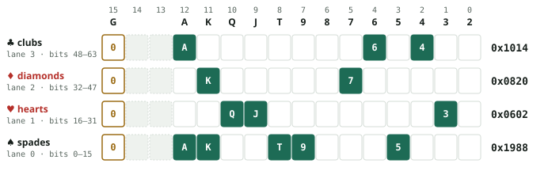
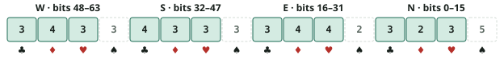
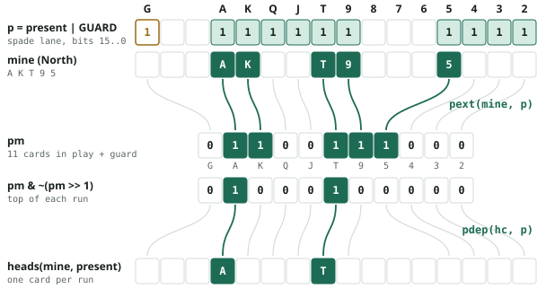

# One Word per Hand

*ddfast · ddclaim · hand representation*

In ddfast (an exact double-dummy solver, about four times faster than DDS on one core) and ddclaim (its sibling for endings of 1 to 7 cards), each bridge hand is a single 64-bit integer. Following suit, finding playable cards, deciding a trick and building table keys are each a few bit operations on four such words.

This page explains that representation well enough to reimplement it. Every excerpt is from the source: `ddclaim/include/ddclaim/tables.hpp` and `port.hpp` (the helpers, shared by both programs), and `ddfast/src/solver.cpp` (the search). The worked examples were checked by running the real helpers on the example hands. Figures come from `ddfast/README.md` and `ddfast/docs/NOTES.md`, and each one names its source.

## The layout

The position is four hand words `H[4]`, indexed by seat (0 North, 1 East, 2 South, 3 West), plus a second word `LENS` that holds the suit lengths. Inside a hand word each suit gets a 16-bit lane. Bit *r* of a lane is rank 2 + *r*, so the two is bit 0 and the ace is bit 12. Bits 13 and 14 are never set. Bit 15 is the **guard** bit. It is always zero in a hand, and the helpers set it in temporary values so that borrows and run detection stop at the edge of each suit.

Example hand used throughout: North holds **♠AKT95 ♥QJ3 ♦K7 ♣A64**.



*North's hand at no trumps is the word `0x1014082006021988`. Each row is one 16-bit lane. Green cells are cards held. The dashed cells (bits 13 and 14) are unused, and the outlined cell on the left of each lane is the guard bit.*

```cpp
constexpr u64 LANE0 = 0x1FFF;
constexpr u64 GUARD = 0x8000800080008000ull;
constexpr u64 ONES = 0x0001000100010001ull;
constexpr u64 ALL_LANES = 0x1FFF1FFF1FFF1FFFull;

constexpr u64 LANE(int s) { return LANE0 << (16 * s); }
inline u64 lane_of(u64 c) { return LANE0 << (__builtin_ctzll(c) & 48); }
inline int suit_of(u64 c) { return __builtin_ctzll(c) >> 4; }
```

*ddclaim/include/ddclaim/tables.hpp, namespace ddclaim::bits*

A single card is a word with one bit set. Its suit is `ctz >> 4`, and its lane mask is `LANE0` shifted by `ctz & 48`. Within one suit, comparing two cards is ordinary integer comparison because a higher rank is a higher bit. The search compares only cards it already knows are in the same lane.

### Trumps always live in lane 3

When the position is loaded, the trump suit swaps lanes with suit 3. After that, "is this card a trump?" is `c & LANE(3)` with a constant mask, and the trump test is fixed at compile time:

```cpp
for (int s = 0; s < 4; s++) {
  int lane = s;
  if (tr < 4) lane = s == tr ? 3 : (s == 3 ? tr : s);
  hq |= u64(p.hand[q][s]) << (16 * lane);
  lens |= u64(__builtin_popcount(p.hand[q][s])) << (16 * q + 4 * lane);
}
```

*ddfast/src/solver.cpp, solve_position*

```cpp
template <bool NT>
struct Cfg {
  static constexpr u64 TR = NT ? 0 : LANE(3);
};
```

*ddfast/src/solver.cpp*

Because the search is a template on `NT`, the no-trump build has `TR = 0` and the ruff tests compile away. The fixed trump lane also helps ddclaim's tables: they sort lanes 0 to 2 (the side suits) by length with a byte shuffle (`shuffle_lanes` / `ddport::shuf8`) and leave lane 3 alone, so equivalent endings share one table entry.

### Suit lengths in a second word

`LENS` is laid out differently from the hands: one 16-bit lane per *seat*, and inside it one 4-bit nibble per suit. Nibble `4*seat + suit`, at bit `16*seat + 4*suit`, holds the length of that holding.



*LENS for a deal where North is 5-3-2-3 (the other seats' lengths are example values). North's lane is `0x3235`. The dashed spade nibbles are dropped from table keys (`lens48`), because each hand's spade length follows from its card count and its other three lengths.*

```cpp
inline int len_of(int seat, int suit) { return int(LENS >> (16 * seat + 4 * suit)) & 15; }
```

*ddfast/src/solver.cpp*

## Core operations, worked on the example

In the examples below, ♠8, ♠7 and ♠6 have already been played. The other spades still out are ♠Q4 (East), ♠J3 (South) and ♠2 (West). The cards in play (`all` or `present` in the code) are `H[0] | H[1] | H[2] | H[3]`. In the spade lane that is A K Q J T 9 5 4 3 2, or `0x1f8f`.

### A card and everything above it

```cpp
inline u64 ge(u64 c) { return lane_of(c) & (0 - c); }       // c and everything above it in its suit
inline u64 above(u64 c) { return ~((c << 1) - 1); }        // all bits above c (any lane)
inline u64 lowest(u64 x) { return x & (0 - x); }
inline u64 highest(u64 x) { return 1ull << (63 - __builtin_clzll(x)); }
```

*tables.hpp*

`0 - c` sets c and every bit above it, and the lane mask trims the result to c's suit. `ge(♠T)` = `0x1f00` = ♠A K Q J T. The top card of a suit is `highest(x & LANE(s))`. The vector code below gets the top card of all four suits at once with a per-lane `lzcnt`.

### fill_up: every card at and above the lowest one, in each suit

```cpp
inline u64 fill_up(u64 x) {
  u64 y = x | GUARD;
  u64 low = y & ~(y - ONES);
  return (GUARD - low) & ALL_LANES;
}
```

*tables.hpp*

The guard bit makes every lane nonzero, so `y - ONES` subtracts 1 in each lane with no borrow crossing a lane boundary. `y & ~(y - ONES)` keeps the lowest set bit of each lane, which is the guard for an empty lane. `GUARD - low` then sets, in each lane, every bit from that lowest bit up to bit 14, and is zero in a lane where low was the guard. `ALL_LANES` trims the result to bits 0 to 12.

Worked: x = {♠J, ♦K}. Then y = `0x8000880080008200`, low = `0x8000080080000200`, and the result is `0x0000180000001e00` = ♠AKQJ and ♦AK. Hearts and clubs are empty.

The search uses this for **relevant cards**, the cards whose ranks a result depends on. If the ♠J mattered, then who holds the A, K and Q matters too. After fill_up, the relevant set in each suit is "the top k cards of the suit", which makes a compact table pattern (see below).

### One card per run of touching cards, with pext and pdep

Cards that touch in play are equivalent: once ♠8, 7 and 6 are gone, North's ♠T, 9 and 5 behave the same. The search tries only one card from each such run. ddclaim and ddfast find the top of every run in one step. `pext` packs the cards in play together so that cards which touch become adjacent bits. A shift and a mask then find the tops, and `pdep` puts the result back in place:

```cpp
inline u64 run_heads(u64 mine, u64 present, u64* seq = nullptr) {
  const u64 p = present | GUARD_BITS;
  const u64 pm = _pext_u64(mine, p), hc = pm & ~(pm >> 1);
  if (seq) *seq = _pdep_u64(hc & (pm << 1), p);
  return _pdep_u64(hc, p);
}
```

*ddclaim/include/ddclaim/port.hpp (x86 version); tables.hpp calls it as bits::heads*



*The spade lane of `heads(North, all)`. pext keeps the 11 positions in play (10 spades plus the guard), packed low. In the packed form a card heads a run when the next card up is not North's. The guard bit is in `p` but never in a hand, so it stops runs at the suit boundary. `pm = 0x338`, `hc = 0x220`, and pdep gives back ♠A and ♠T. The optional `seq` output marks heads that have another card of the run below them.*

Over the whole hand, `heads(North, all)` returns 9 candidates out of 13 cards: ♠A T, ♥Q 3, ♦K 7, ♣A 6 4. (The ♣6 and ♣4 are separate runs because the ♣5 is still in play.)

The search also needs the bottom of a run. When a run wins a trick, the relevant card is the lowest card of the winning run, so `run_bottom` uses the same packing:

```cpp
inline u64 run_bottom_of(u64 c, u64 rest, u64 present) {
  const u64 p = present | GUARD_BITS;
  const u64 pm = _pext_u64(rest, p), bc = _pext_u64(c, p);
  const u64 t = ~pm & (bc - 1);
  const u64 bb = 1ull << (64 - _lzcnt_u64(t));  // just above the highest gap below c, or bit 0
  return _pdep_u64(bb, p);
}
```

*port.hpp (x86)*

Worked: `run_bottom(♠T, North without ♠T, all)` = ♠5.

### Following suit

The candidate cards at a follow node take two lines. With `lane` the mask of the suit led, the player follows suit if possible and otherwise may play anything:

```cpp
const u64 mine = H[s];
const u64 in_suit = mine & lane;
u64 cand = heads(in_suit ? in_suit : mine, all);
```

*ddfast/src/solver.cpp, follow()*

At a lead node it is just `heads(H[L], all)`.

### Who wins the trick

The state of a trick is the best card so far (`best`, one bit), its seat (`bw`), and a flag `ranked`. The flag says whether the current winner beat a card of its own suit, meaning its rank decided the trick:

```cpp
template <bool NT>
inline void trick_step(u64 x, int s, u64& best, int& bw, bool& ranked) {
  constexpr u64 TR = Cfg<NT>::TR;
  const bool same = (x & lane_of(best)) != 0, ruff = (x & TR) != 0;
  const bool beats = same ? x > best : ruff;
  if (beats) best = x, bw = s;
  ranked = same | (ranked & !ruff);
}
```

*ddfast/src/solver.cpp (follow() inlines the same three lines)*

Worked, with hearts as trumps (so hearts are lane 3): North leads ♠T, East plays ♠Q, South (void) ruffs with ♥5, West overruffs with ♥9.

| card        | same | ruff | beats  | best after | ranked |
|-------------|------|------|--------|------------|--------|
| N ♠T (lead) |      |      |        | ♠T, N      | 0      |
| E ♠Q        | 1    | 0    | Q \> T | ♠Q, E      | 1      |
| S ♥5        | 0    | 1    | ruff   | ♥5, S      | 0      |
| W ♥9        | 1    | 1    | 9 \> 5 | ♥9, W      | 1      |

West wins. The relevant cards for the trick are then `ge(best) & (0 - u64(ranked))` = `0x1f80000000000000` (♥9 and every trump above it). If South's ruff had stood, `ranked` would be 0 and no ranks would matter. At the end of a trick ddfast uses the bottom of the winner's run:

```cpp
const u64 Rt = (RUNOPT ? ge(nb) : ge(run_bottom(nb, H[nbw], all))) & (0 - u64(nr));
```

*ddfast/src/solver.cpp, follow(), K == 3*

## Make and unmake: one XOR and one nibble

Playing a card clears its bit in the hand and decrements one length nibble. Taking it back reverses both:

```cpp
inline void play(int s, u64 c) { H[s] ^= c; LENS -= 1ull << (16 * s + 4 * suit_of(c)); }
inline void unplay(int s, u64 c) { H[s] ^= c; LENS += 1ull << (16 * s + 4 * suit_of(c)); }
```

*ddfast/src/solver.cpp (lead() and follow() write the same two lines inline)*

Nothing else needs updating. The cards in play, the top cards of each suit, the runs and the winners are all recomputed from the four words when they are needed. Compare the position that DDS maintains per node. ddfast's line-by-line port of DDS (`src/dds_port.hpp`) mirrors it as:

```cpp
struct Pos {
  unsigned short rank_in_suit[4][4];  // holdings now
  unsigned short aggr[4];             // all hands' cards of each suit now
  unsigned char length[4][4];
  HighCardType winner[4], second_best[4];  // top two cards of each suit at the start of the trick
  HighCardType third[4];                   // the third-best card of each suit now
  ...
```

*ddfast/src/dds_port.hpp*

Early ddfast still filled this struct to call the ported DDS bounds and move ordering. The notes record the gain from rewriting those on the hand words:

- Round 4: follow-node moves generated with pext/pdep instead of the port's ordering, 25.9M → 25.5M cycles per deal.
- Round 6: DDS's lead weights (`native_order`) and second-hand quick tricks rewritten on the 64-bit words, 25.1-25.6M → 22.7-23.0M cycles per deal (−9%). These are checked against the port on every call under `-DVERIFY_ORDER`.
- Round 7: lead-node QuickTricks and LaterTricks rewritten on the words, with "top/second/third cards found with lzcnt per lane, owners from three bit tests, lengths from LENS". After this no port position is built at lead nodes.

*ddfast/docs/NOTES.md, Rounds 4, 6 and 7*

## Table keys from the same words

A transposition-table entry records which cards mattered and who held them, not the cards themselves. ddfast builds the key from `LENS` and builds the pattern by compressing the hands with `pext` over the cards in play:

```cpp
const u64 all = H[0] | H[1] | H[2] | H[3];
const ddport::BitMask bm_(all);
const u64 ewq = bm_.ext(H[1] | H[3]), swq = bm_.ext(H[2] | H[3]);
const u64 key54 = lens48(LENS) | u64(L) << 48 | u64(n) << 50;
```

*ddfast/src/solver.cpp, lead()*

- **key54**: the 48 bits of suit lengths (`lens48` keeps suits 1 to 3 of each seat), the leader and the number of cards per hand. Entries under one key share every hand's suit lengths, so a given position in the packed order is the same *relative* rank in every position under that key.
- **ewq, swq**: two bits per card in play, in packed order. The ewq bit means East or West holds it, and the swq bit means South or West holds it. So North = 00, East = 10, South = 01, West = 11.

Worked, spade lane only (packed low to high: 2 3 4 5 9 T J Q K A): ewq = `0x85` (bits for ♠2 W, ♠4 E, ♠Q E), swq = `0x43` (♠2 W, ♠3 S, ♠J S).

To store an entry, the relevant cards `Racc` are packed the same way. Because of fill_up they are the top block of each suit:

```cpp
const u64 m = ddport::pext64(Racc, all);
...
const u64 mm = m | m << 28;
e[cnt] = (ewq | swq << 28) & mm;
// Bit 55 + t: the entry decides target t (1..7); bit 63: the answer.
const u64 dec = res ? (1ull << target) - 1 : 0x7Full & ~((1ull << (target - 1)) - 1);
e[8 + cnt] = mm | dec << 56 | u64(res) << 63;
```

*ddfast/src/solver.cpp, tt_store (narrow entries, up to 7 cards a hand; wide entries for 8+ use three 52-bit words)*

For example, if the top three spades mattered, `m = pext(fill_up(♠Q), all)` is `0x380` in the spade part, and `pdep(0x380, all)` gives back ♠AKQ. On a hit the stored mask is expanded onto the *current* position's cards, so a pattern learnt in one position names the corresponding cards in another:

```cpp
R = fill_up(ddport::pdep64(bb & 0xFFFFFFF, all));
```

*ddfast/src/solver.cpp, tt_lookup*

### AVX-512: eight entries per compare

Entries sit in blocks of eight: eight owner patterns in one 64-byte line and their masks in the next. A lookup compares all eight with one masked compare and tests the "decides this target" bit:

```cpp
inline unsigned tt_match_narrow(const u64* e, u64 own, u64 dec) {
  const __m512i vb = _mm512_load_si512(e + 8);
  const unsigned k = _mm512_cmpeq_epi64_mask(_mm512_and_si512(vb, _mm512_set1_epi64((long long)own)), _mm512_load_si512(e));
  return k & _mm512_test_epi64_mask(vb, _mm512_set1_epi64((long long)dec));
}
```

*ddfast/src/solver.cpp*

ddclaim's pattern tables use the same idea (`ddport::pmatch8`), and its two- and three-card table probes rank the owner strings with `pext` and look up a precomputed answer.

### The per-suit vector lanes in native_order

DDS's lead-ordering weights depend on per-suit facts: lengths, the top three cards and who holds them. ddfast widens each 16-bit suit lane of a hand word to a 32-bit vector lane and computes all four suits at once:

```cpp
auto ld = [](u64 h) { return _mm_cvtepu16_epi32(_mm_cvtsi64_si128((long long)h)); };
auto hib = [](V v) { return _mm_srlv_epi32(_mm_set1_epi32(int(0x80000000u)), _mm_lzcnt_epi32(v)); };
...
const V X = ld(all), VL = ld(hl), VP = ld(hp), VA = ld(ha), VB = ld(hb);
const V lenA = _mm_popcnt_epi32(VA), lenB = _mm_popcnt_epi32(VB), lenP = _mm_popcnt_epi32(VP);
const V top1 = hib(X), X2 = _mm_xor_si128(X, top1), top2 = hib(X2), top3 = hib(_mm_xor_si128(X2, top2));
const M w1L = tst(top1, VL), w1P = tst(top1, VP), w1A = tst(top1, VA), w1B = tst(top1, VB);
```

*ddfast/src/solver.cpp, native_order (AVX-512VL)*

The per-card part then gets the candidate cards (the run heads) into one zmm register, one card per 32-bit lane. It bit-reverses each suit (`gf2p8affine` + `pshufb`) and compresses the bit positions (`vpcompressb`). NOTES.md (Round 9) gives the gains: the per-suit vector part −5.3% cycles and the per-card zmm part −3.2%.

## Costs and limits

- **Instruction set.** The x86 build needs BMI2 (pext, pdep) and AVX-512. The README lists Zen 4/5 and Intel Ice Lake and later. `tables.hpp`: "Requires an x86-64 CPU with AVX-512 and BMI2 ... or AArch64 (Apple silicon; see port.hpp)."
- **pext speed varies by CPU.** On Zen 1 and Zen 2, pext and pdep are microcoded and much slower than on Intel or Zen 3 and later. *(This is general hardware knowledge, not something stated in either repository. Those CPUs also lack AVX-512, so the x86 build does not run on them.)*
- **Arm has no pext or pdep.** `port.hpp` emulates them a byte at a time through two 256×256 tables (64 KB each, so both fit in a performance core's 128 KB L1). Each byte's output offset is a prefix sum of the mask's byte popcounts, from one NEON `cnt` and a multiply. The README puts this at "about 50 instructions for what is one instruction on x86". The run finder avoids pext entirely on Arm and uses an add-and-carry trick on bit-reversed words instead:

```cpp
inline u64 run_heads(u64 mine, u64 present, u64* seq = nullptr) {
  const u64 gaps = __builtin_bitreverse64(~present & ~GUARD_BITS);
  const u64 seeds = __builtin_bitreverse64((present & ~mine) | GUARD_BITS) << 1;
  const u64 stop = (((seeds & gaps) + gaps) & ~gaps) | (seeds & ~gaps);
  const u64 h = __builtin_bitreverse64(__builtin_bitreverse64(mine) & stop);
  if (seq) *seq = h & next_up(mine, present);
  return h;
}
```

*port.hpp (AArch64 version)*

A carry started just below each card in play that is not mine (or the suit's guard) runs through the gaps left by played cards and stops at the next card in play. If that card is mine, it heads a run. The AVX-512 table matches become two-lane NEON compares.

## Figures and where they come from

| figure | value | source |
|----|----|----|
| Single problems, 600 random deals, one Zen 5 core | 271 vs 63 deals/s (4.3x) | README, Speed |
| Full tables, 200 deals, one thread | 33.9 vs 133.8 ms (3.9x) | README, Speed |
| ddfast, public set | 16.1M cycles/deal | README, Speed |
| DDS on Zen 5 | about 80M cycles/deal | README, macOS port |
| Nodes searched, public set (final code) | 84.84M (141.4k/deal) | NOTES, Rounds 11-12 |
| Cycles and instructions at that node count | 17.40M cycles, 40.05M instr./deal | NOTES, Round 12 |
| Cycles per node (derived: 17.40M / 141.4k) | about 123 | computed from NOTES |
| Earlier version: time per node | about 37 ns at 207,000 nodes/deal | NOTES, Round 3 |
| DDS search calls per deal | 230,000 | NOTES, Rounds 3 and 5 |
| Apple M5 port | 55M vs 40M instr.; 15.5M vs 16.1M cycles | README, macOS port |
| Ratio to DDS on the Mac | about 3x (3.1x single problems) | README |

> [!NOTE]
> The cycles-per-node figure is a quotient of two numbers from the same NOTES round, not a measurement. The README's 16.1M cycles per deal is a later build than the Round 12 figures. The 37 ns per node comes from an earlier version that searched 207,000 nodes per deal.
