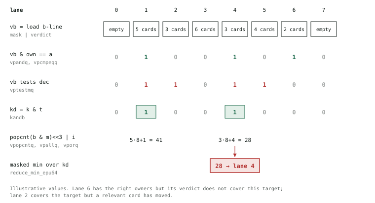

# ddfast Pattern Table

*ddfast · src/solver.cpp*

How an exact double-dummy solver stores what it proved as card patterns, and checks eight of them against the current position in a handful of AVX-512 instructions.

Sections:

- [The idea](#the-idea)
- [Key and directory](#key-and-directory)
- [Entries](#what-an-entry-holds)
- [Matching a block](#matching-a-block)
- [Storing](#storing-a-result)
- [ddclaim's table](#the-same-scheme-in-ddclaims-4-card-table)
- [Why it pays](#why-it-pays)
- [Tried, not kept](#tried-and-not-kept)

<!-- -->

- **4.3x** DDS's speed on 600 random deals (271 vs 63 deals/s). README
- **16 / 24 B** per pattern: up to 7 cards a hand / 8 and more. solver.cpp
- **8 patterns** tested per block with one load-and-compare sequence. solver.cpp
- **~23%** of cycles in the table, about half memory latency. NOTES, round 9

## The idea

ddfast answers yes/no questions: "with this leader, can North-South take at least `target` of the remaining `n` tricks?" Every search node returns that answer plus `R`, the set of cards the proof depended on. If a proof only needed "North holds the ace and king of spades, East the queen", it holds for every position with the same suit lengths and leader where those cards (counted among the cards still in play) have those owners. Where the other cards sit does not matter.

So a table entry is a *pattern*, not a position: a mask of the cards that mattered, their owners, and which targets the proof settles. One entry answers many positions. Finding the entry means testing each candidate pattern against the current hands, and that test is what ddfast vectorises: eight patterns at a time.

The table is per deal. It is reset whenever the deal or the strain changes, and persists over the several target questions asked about one deal (2.39 questions per deal on average, NOTES "Final state (round 5)"). It is used from 4 cards a hand upward (`TT_MIN = 4`); smaller endings use ddclaim's 2- and 3-card tables and other cutoffs.

## Key and directory

Patterns are grouped under an exact key: the length of every hand in three of the four suits (the fourth follows from the card count), the leader, and the cards per hand. That is 54 bits:

```cpp
const u64 key54 = lens48(LENS) | u64(L) << 48 | u64(n) << 50;
```

*solver.cpp, lead(). lens48 packs 12 bits (4 seats x 3 suits) per lane: 48 bits; leader 2 bits; n 4 bits.*

Because the key fixes every suit length in every hand, the cards still in play line up the same way for every position with that key once they are *compressed*: `pext` over the 52-bit set of cards present squeezes out the cards already played, so bit *i* of a compressed mask means "the *i*-th lowest remaining card", which is the same suit and relative rank in every position with this key. With 7 cards a hand there are at most 28 cards in play, so a compressed mask fits in 28 bits; from 8 cards it needs up to 52.

### The directory

The key maps to a 16-byte `DirSlot` in an open-addressed (linear probing) array with a multiplicative hash:

```cpp
struct DirSlot {
  u64 key;  // key54 | hint << 54 | count in the head block << 60
  uint32_t gen, head;
};
inline DirSlot* find(u64 key54) {
  size_t h = (key54 * 0x9E3779B97F4A7C15ull) >> (64 - bits);
  for (;;) {
    DirSlot& d = dir[h];
    if (d.gen != gen) return nullptr;
    if ((d.key & ((1ull << 54) - 1)) == key54) return &d;
    h = (h + 1) & ((size_t(1) << bits) - 1);
  }
}
```

*solver.cpp, struct TT.*

- **O(1) reset.** A slot is live only if its `gen` equals the table's. Resetting for a new deal is `++gen`; the directory is memset only when the 32-bit counter wraps.
- **Growth.** The directory starts at 2<sup>11</sup> slots (`DIR_MIN`) and, when it is half full, rehashes into 4x the size (`bits += 2`), up to 2<sup>20</sup> (`DIR_MAX`). Past that, or when the block pool is full, the whole table is reset; the notes report these paths checked exact with deliberately tiny tables.
- **Spare bits.** The top 10 bits of `key` carry a best-move hint (6 bits: the card's index among the cards present, 63 for none) and the number of patterns used in the newest block (4 bits, 0-8).

### Chains of blocks from a per-deal pool

`head` points into a pool of 64-byte lines (2<sup>22</sup> lines, `POOL_BITS`) handed out in order. A block is 8 patterns: 2 lines for narrow entries, 3 for wide. When the head block is full, a new block is taken from the pool and pushed on the front of the key's chain; a parallel array `next[]` links it to the older one. Nothing is ever evicted during a deal, and a deal's table is one compact, growing region. Huge pages are requested for the directory, pool and links with `madvise`.

![A directory slot with key, generation and head index points to the newest block in the pool; each block links through next[] to the older block of the same key until NIL.](img/table-search-directory.svg)

*Figure 1. One key, one chain. The directory slot holds the head of a singly linked list of 8-pattern blocks; new blocks go on the front, so a lookup sees the most recent patterns first. A slot whose `gen` is stale reads as empty, which is how the table resets in O(1).*

## What an entry holds

Owners are encoded with two bit strings over the cards present, computed once per node:

```cpp
const u64 ewq = bm_.ext(H[1] | H[3]), swq = bm_.ext(H[2] | H[3]);
```

*solver.cpp. Seats N E S W are 0..3 (include/ddfast.hpp). `bm_.ext` is pext over `all`, the cards present.*

A card's bit in `ewq` is set if East or West holds it, in `swq` if South or West does, so the pair (ewq, swq) is the seat number: N = 00, E = 10, S = 01, W = 11. A pattern stores its mask `m` and the two strings ANDed with `m`. It matches the current position when `(ewq & m, swq & m)` equal the stored strings: every card that mattered has the same owner. Since the key fixes the suit lengths, cards outside the mask can be anywhere.

### Narrow entries: up to 7 cards a hand, 16 bytes

With at most 28 cards present, both owner strings fit in one word side by side (`own = ewq | swq << 28`). The second word holds the mask, doubled to line up with both halves, plus 8 bits of verdict. Instead of lower and upper bounds on North-South's tricks, a narrow entry stores the set of targets it decides: an entry from `tt_store` either says "reaches `target`", which settles every *t* ≤ target, or "does not reach it", which settles every *t* ≥ target. One bit per target 1..7 at bit 55 + *t*, and the answer at bit 63. This replaced lo/hi in round 9 and turns the bound check into one `vptestmq`.

### Wide entries: 8 or more cards a hand, 24 bytes

Up to 52 cards present means each owner string needs its own word. `w0` holds the 52-bit mask with `lo` in bits 52-55 and `hi` in 56-59 (bounds on North-South's tricks; a stored "yes" is \[target, n\], a "no" is \[0, target-1\]); `w1` and `w2` hold the masked owner strings. The entry decides the question if `lo ≥ target` (yes) or `hi < target` (no).


*Figure 2. Entry formats and block layout. Storing the eight `a` words in one cache line and the eight `b` words in the next means each 64-byte line is exactly one 512-bit register of eight lanes.*

## Matching a block

The narrow test, for all 8 entries at once, is `(b & own) == a` and `b & dec != 0`, where `dec = 1 << (55 + target)`. Because `own` only has bits 0-55, the AND strips b's verdict bits and leaves the masked owners. An empty slot (`a = ~0`) can never equal anything ANDed with own.

```cpp
inline unsigned tt_match_narrow(const u64* e, u64 own, u64 dec) {
  const __m512i vb = _mm512_load_si512(e + 8);
  const unsigned k = _mm512_cmpeq_epi64_mask(
      _mm512_and_si512(vb, _mm512_set1_epi64((long long)own)), _mm512_load_si512(e));
  return k & _mm512_test_epi64_mask(vb, _mm512_set1_epi64((long long)dec));
}
```

*solver.cpp. Two loads, `vpandq`, `vpcmpeqq`, `vptestmq`, a mask AND. The broadcasts of `own` and `dec` do not change along the chain, so the compiler can hoist them.*

The wide version does the same on three lines: mask out `lo`/`hi` from `w0`, compare `w0 & ewq` to `w1` and `w0 & swq` to `w2`, and test the bounds with two shifts, two masks and two compares:

```cpp
return k & (_mm512_cmpge_epi64_mask(vlo, vt) | _mm512_cmplt_epi64_mask(vhi, vt));
```

*solver.cpp, tt_match_wide. On ARM the same functions run on four 2-lane NEON vectors and a movemask.*

### Choosing the narrowest match

Any deciding entry gives a correct answer, but the entry also returns `R`, the cards the answer depended on, which the parent node folds into its own pattern. Fewer cards in `R` make the parent's pattern more general. So when more than one lane matches (`kd & (kd - 1)`), ddfast picks the entry with the fewest mask bits, packing popcount and lane index into one key and taking a masked minimum:

```cpp
inline u64 tt_min_pc(const u64* v, u64 m, unsigned kd) {
  const __m512i pcv = _mm512_or_si512(
      _mm512_slli_epi64(_mm512_popcnt_epi64(_mm512_and_si512(_mm512_load_si512(v), _mm512_set1_epi64((long long)m))), 3),
      _mm512_set_epi64(7, 6, 5, 4, 3, 2, 1, 0));
  return _mm512_mask_reduce_min_epu64(__mmask8(kd), pcv);
}
```

*solver.cpp. Called with the `b` line and `m = 0xFFFFFFF` (narrow) or the `w0` line and `W52` (wide). The result is `popcount << 3 | lane`; ties go to the lowest lane.*

The lookup stops at the first block with any deciding entry (`TTPICK=1`, the default); it does not search later blocks for a narrower one. The chosen mask is expanded back to card bits and widened so that every card above a relevant card in its suit counts too:

```cpp
R = fill_up(ddport::pdep64(bb & 0xFFFFFFF, all));
return bb >> 63;
```



*Figure 3. The match step on one narrow block. Owner equality and the target test each produce an 8-bit mask; their AND is the set of entries that decide the question here. With two or more survivors, the popcount key picks the most general one. A single survivor skips the popcount (`__builtin_ctz(kd)`).*

## Storing a result

`tt_store` runs when a node finishes, and also when the DDS-derived quick-trick bounds or ddclaim's 4-card pattern table settle a node, because finding the answer again in this table is cheaper than recomputing it (comments in solver.cpp). It appends to the key's newest block; patterns are never tightened in place or deduplicated.

```cpp
const u64 m = ddport::pext64(Racc, all);   // cards that mattered, compressed
...
const u64 mm = m | m << 28;
e[cnt] = (ewq | swq << 28) & mm;
// Bit 55 + t: the entry decides target t (1..7); bit 63: the answer.
const u64 dec = res ? (1ull << target) - 1 : 0x7Full & ~((1ull << (target - 1)) - 1);
e[8 + cnt] = mm | dec << 56 | u64(res) << 63;
```

*solver.cpp, tt_store (narrow branch). The wide branch writes `m | lo << 52 | hi << 56`, `ewq & m`, `swq & m`.*

If the node found a best card, its index among the cards present (`popc(all & (bestc - 1))`) goes into the slot's 6-bit hint. A lookup that misses still returns that hint, and move ordering tries it first.

## The same scheme in ddclaim's 4-card table

ddfast also reads ddclaim's precomputed pattern table for 4-card endings (filled by solving random endings, then frozen). Its entries use the same `a`/`b` split with 8-entry groups, but keep 3-bit lo/hi bounds in bits 56-58 and 59-61, and its key is leader-relative with the side suits sorted. Its match is the narrow test with the bounds test of the wide one:

```cpp
inline unsigned pmatch8(const u64* a, const u64* b, u64 own, int tl) {
  ...
  const unsigned k = _mm512_cmpeq_epi64_mask(_mm512_and_si512(vb, vo), _mm512_load_si512(a));
  const __m512i vlo = _mm512_and_si512(_mm512_srli_epi64(vb, 56), _mm512_set1_epi64(7));
  const __m512i vhi = _mm512_and_si512(_mm512_srli_epi64(vb, 59), _mm512_set1_epi64(7));
  return k & (_mm512_cmpge_epi64_mask(vlo, vt) | _mm512_cmplt_epi64_mask(vhi, vt));
}
```

*ddclaim, include/ddclaim/port.hpp, called from probe_pattern in include/ddclaim/tables.hpp.*

Differences that follow from the table being read-only and large: the directory points to a contiguous run of groups (all `a` lines, then all `b` lines), not a chain; `probe_pattern` prefetches 8 groups at a time (`P_CHUNK`); it takes the first deciding entry (choosing the narrowest there, `PPICK=1`, saved only 0.26% of nodes and was left off, NOTES round 7). A 4-card hit is copied into the per-deal table, which cut 4-card probes from 6.2M to 1.7M per 600 deals and saved 3% (NOTES round 3).

## Why it pays

The table's design came out of one finding: on full deals the solver's node count was limited by how many patterns it could keep per key, not by move ordering. All figures below are from `docs/NOTES.md`, measured on the public set of 600 random deals unless noted.

| Change | Effect | Source |
|----|----|----|
| One 8-pattern bucket per suit-length key (shared table) | 80% of stores evicted a live entry | Round 2 |
| Chain 4 buckets per key / 16 buckets | 374M → 165M / 130M nodes (DDS: 138M search calls) | Round 2 |
| Per-deal directory, chains from a pool, never evicts; 16 B / 24 B entries | 123M nodes, 9.8-10.7 ms/deal | Round 2 |
| Probe the table before DDS-style quick tricks | half of lookups hit; 9.7 → 7.0-7.7 ms | Round 3 |
| Narrowest deciding entry within the hit block (TTPICK=1) | nodes -3.3%, cycles -1.5% | Round 7 |
| Decided-target mask in narrow entries (one vptestmq) | instructions 46.07M → 45.67M, cycles -1.1% | Round 9 |
| Huge pages (all tables) | about 2% of cycles | Round B |

**Blocks scanned.** Hits scan 1.2 blocks at *n* = 4, 2.2 at *n* = 6 and 2.7 at *n* = 7; misses scan 3.3 blocks at *n* = 6 (NOTES round 9). A typical lookup is a directory probe plus two or three dependent block loads.

**Cost.** In round 9's profile `tt_lookup` and `TT::find` took 21% of samples and `tt_store` 4.3%; the table was "the biggest single cost (~23% of cycles, about half memory latency)". Earlier gprof runs put the lookup at 13% (rounds 3 and 5). A double-call measurement gave the lookup +6.5M instructions and +1.9M cycles per deal.

**End result.** The README reports 271 deals/s against DDS's 63 (4.3x) on single problems and 16.1M cycles per deal on the public set. The final notes report 84,841,515 nodes on the public set (141.4k per deal), against 230,000 DDS search calls per deal measured in round 5. Those gains come from the whole solver, not the table alone.

## Tried and not kept

The table's remaining cost is mostly memory latency, and the obvious latency fixes did not help. Cycles are per deal on the public set.

| Attempt | Result |  | Source |
|----|----|----|----|
| Prefetch the pattern-table directory and entries early in the node | no gain: "the search has no slack to hide a memory miss" | dropped | Round 3 |
| Interleave 2-8 deals on one thread, each with its own table | 9.7 ms (1) vs 10.8, 13.0, 12.5 ms (2, 4, 8) | dropped | Round 3 |
| First two patterns of a key inside a 64-byte directory slot | 27.1M vs 25.0-25.6M: directory 4x larger, out of cache | dropped | Round 5 |
| 4-pattern single-line blocks for ≤ 7 cards | 25.6M, no gain | dropped | Round 5 |
| Tighten a matching pattern in place instead of appending | 26.2M vs 25.8M | dropped | Round 5 |
| Scan every block for the narrowest entry (TTPICK=2) | nodes -4.4% but cycles +2.7% | off | Round 7 |
| Narrowest pick with a scalar loop on every hit | +1% cycles (the vector version replaced it) | rewritten | Round 7 |
| Prefetch the next lead's directory slot from the last follow node | 20.33M → 20.58-20.69M | dropped | Round 9 |
| Prefetch the next block of the chain while scanning | no difference within noise | dropped | Round 9 |
| Newest block inside a 256-byte directory slot (no dependent load) | cycles equal (18.30M vs 18.32M); cache misses 47.6k → 75.5k per deal | dropped | Round 9 |
| Directory filled to 3/4 instead of 1/2 | worse (18.51M) | dropped | Round 9 |
| Per-slot lo/hi summary to skip chains that cannot decide | would skip only 2-9% of misses (measured first) | not built | Round 9 |

> [!NOTE]
> Round 11 adds why the first-block-in-slot idea cannot be revisited cheaply: since the lookup takes the matching entry with the fewest cards, keeping node counts identical would require scanning the whole first block anyway.

## Reimplementing it: the checklist

1.  Make every search return the set of cards its proof used; widen it so higher cards in the same suit count too (`fill_up`).
2.  Key on exact suit lengths per hand, leader and card count. Compress masks and owners over the cards present with `pext`.
3.  Encode owners as two bit strings (E\|W, S\|W) so the match is AND-and-compare.
4.  Store 8 entries per block as separate 64-byte lines per word, so one lane equals one entry.
5.  Pack the verdict into spare high bits: a decided-target mask for small endings, lo/hi when owners take whole words.
6.  Never evict within a deal: per-deal pool, chained blocks, generation-tagged open-addressed directory.
7.  On a multi-lane hit, return the entry with the fewest relevant cards.
